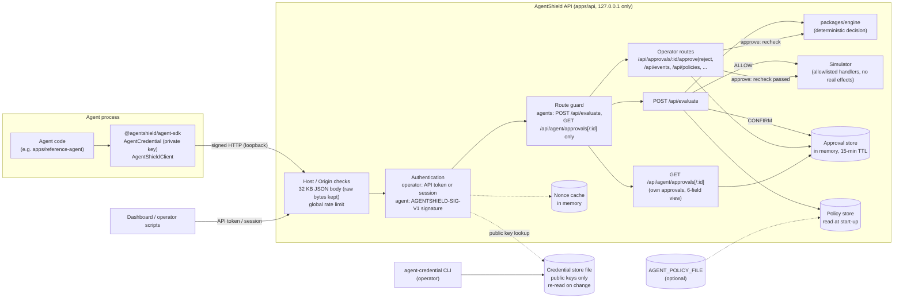
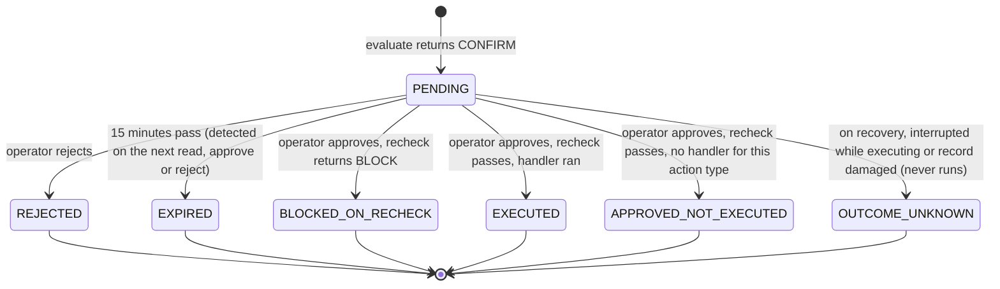

# Architecture: agent integration (M3-C to M3-E E6)

This document explains how an agent request travels through AgentShield. It covers the code
as it is at M3-E E6, from the signed request to the approval decision.

**Other documents.**
- For a hands-on walk-through, see [quick-start.md](quick-start.md).
- For what this does and does not protect, see [security-model.md](security-model.md).
- The authoritative reference for credentials and signed requests is
  [agent-identity.md](agent-identity.md). For policies, it is
  [agent-policies.md](agent-policies.md).

## Components

| Package | Role |
|---|---|
| `packages/agent-protocol` (E1) | The signed-request format: header parsing and formatting, the canonical request bytes, body hashing. Shared by the SDK (signing) and the API (verification). It does not sign, verify or keep state. |
| `packages/agent-sdk` (E5) | The official TypeScript client. It holds the agent's Ed25519 private key, signs each request, and calls three routes. |
| `apps/reference-agent` (E6) | A complete, harmless agent built only on the SDK. |
| `apps/api` | The Express API: request guards, operator and agent authentication, signature verification (E3), the replay cache, policy lookup, evaluation, approvals, events, and the credential CLI. |
| `packages/engine` | The deterministic decision engine: injection scanner, hard deny, data-leak guard, intent firewall. It is authoritative for decisions. |
| `apps/web` | The operator dashboard. It renders API responses only. |

## Overview



**Solid arrows** are requests or calls; **dotted arrows** are reads of state. The diagram
shows the routes relevant to agents. Website scanning, model status and the sign-in routes
are left out.

## 1. Signed protocol and canonical request (E1)

An agent sends exactly one authentication header:

```text
Authorization: AGENTSHIELD-SIG-V1 keyId="<16 hex>", ts="<13-digit Unix ms>", nonce="<22 base64url>", sig="<86 base64url>"
```

**The signature** is an Ed25519 signature over the canonical request. That is the UTF-8
bytes of these eight lines, joined with LF and with no trailing LF:

```text
AGENTSHIELD-SIG-V1
<METHOD>               upper case, as sent
<host>                 the Host header, ASCII lower-cased, otherwise unchanged
<target>               path and query exactly as sent: never decoded, re-encoded or normalised
<ts>
<nonce>                16 random bytes
<keyId>
<body-sha256>          lower-case hex SHA-256 of the exact raw body bytes (zero bytes if none)
```

**One implementation.** The format is defined once, in
`packages/agent-protocol/src/canonical.ts`. The SDK signs with it and the API verifies with
it, so the two cannot drift apart.

**The protocol package itself** checks formats only:
- the header is at most 512 characters;
- the target is RFC 3986 origin-form, at most 2,048 characters;
- the encodings are canonical.

It has no notion of time, keys or nonces.

## 2. Ed25519 credential lifecycle (E2)

**Issuing.** The operator issues credentials with
`npm run agent-credential -w @agentshield/api -- create|list|revoke|rotate`.
- **The key pair** is generated by the CLI. The private key goes to the agent once, as
  `asag2_<keyId>.<base64url PKCS#8 DER>`, on standard output or in a `--out` file
  restricted to the current Windows user.
- **The credential store** keeps only the raw public key. The store is
  `%LOCALAPPDATA%\AgentShield\agent-credentials.json`, or `AGENT_CREDENTIAL_FILE`. It is
  schema 2 and restricted to the current user.

**The store's rules.**
- Each record has a public `keyId`, `agentId`, `createdAt`, `expiresAt` (90 days by
  default, 365 at most) and `revokedAt`.
- An agent can have at most 4 active credentials. That leaves room to rotate without
  downtime.
- The API re-reads the store at most every 2 seconds, on use, when its size, timestamps
  or file id change.
- A revocation therefore reaches a running API within 2 seconds.
- A store that becomes invalid rejects every agent credential until it is fixed. It never
  falls back to the old contents.

**Legacy bearer credentials** (`asag_...`, M3-D) still load. They authenticate only while
`AGENT_BEARER_ALLOWED` is exactly `true`, a temporary migration setting.

## 3. Timestamp validation and replay protection (E3)

**What the server reads.** Express keeps the exact raw body bytes while parsing JSON (32 KB
limit). Body errors get fixed-text `400`, `413` or `415` before authentication runs.

**The checks, in order** (full detail in
[agent-identity.md](agent-identity.md#signed-requests-m3-e-e3)):

1. **Header** format.
2. **Start-up fence.** `ts` must not be earlier than the moment this API process started.
3. **Clock skew.** `ts` must be within ±30 seconds of the server clock
   (`AGENT_SIGNATURE_MAX_SKEW_SECONDS`, 5 to 300).
4. **Body** constraints: read as JSON, no `Content-Encoding` other than identity.
5. **Canonical request**, rebuilt from what was actually received.
6. **Key.** The key id must name an active Ed25519 credential. One Ed25519 verification
   always runs, against a dummy key when the key id is not usable.
7. **Signature.** Ed25519 verification, plus libsodium-style checks: R not of small
   order, S below the group order.
8. **Replay.** Only after a valid signature is `(keyId, nonce)` recorded in the in-memory
   replay cache, until its timestamp leaves the skew window. A repeat is a replay.

**Responses.** Every failure gets the same `401`. The reason goes only to the server log,
as `agent-auth status=failed scheme=signature reason=...`.

**Replay-cache limits.** These reply `429` or `503` with `Retry-After`, and are not counted
as failed authentication:
- at most 600 live nonces per key;
- at most 100,000 in total.

Live nonces are never evicted to make room.

**Restarts (M3-E E11).** Every accepted nonce is appended to a durable journal and fsynced
before the request proceeds, and live nonces are loaded back at start-up, so a restart
cannot reset replay protection. If replay state may be incomplete (a new or deleted journal,
an unreadable record), requests dated up to start-up + skew are refused (503) until then.
The start-up fence still refuses anything signed before the restart. Details:
[replay-and-idempotency.md](replay-and-idempotency.md).

## 3a. Evaluation idempotency (M3-E E11)

An agent's evaluation may carry `idempotencyKey` in its signed body (the SDK sends one).
Records are per agent and bound to a digest of the request. The rules:
- **A retry with the same key and request** returns the stored result
  (`idempotentReplay: true`), including the original approval reference, without
  evaluating again.
- **Another request with that key** is refused (`409 idempotency-key-reused`).
- **A concurrent duplicate** waits for the first.
- **A key that started but whose result was lost** is `409 idempotency-outcome-unknown`,
  never re-run.

The "started" record is stored durably before the evaluation runs. Records last 15
minutes. It runs after authentication, validation and the audit check, and never bypasses
them. Details: [replay-and-idempotency.md](replay-and-idempotency.md).

## 4. Authentication and authorization boundaries

| | Operator | Agent |
|---|---|---|
| **Authenticates with** | The API token (`Authorization: Bearer`) or a dashboard session cookie | A signed request with its Ed25519 key |
| **May call** | Every `/api` route except custom evaluations and `/api/agent/*` | `POST /api/evaluate` (custom requests) and `GET /api/agent/approvals[/:id]`, nothing else |
| **Identity** | One shared operator: no users or roles | The `agentId` of the credential's record; never taken from the request |

**One route guard.** It sits before all route handlers and answers every other route with
`403 operator-required`, so routes added later are operator-only by default. That
includes approve and reject: an agent can never approve or reject.

**A body `agentId`.** It may only repeat the credential's agent. A different one is
`403 agent-identity-mismatch`, recorded as a security event; nothing is evaluated.

**Seeded scenarios** are operator-only, and custom evaluations are agent-only.

## 5. Server-side policy enforcement (M3-C)

For a custom evaluation, the API takes the authenticated agent's policy from the policy
store. That is the built-in `demo-summarizer` policy, or `AGENT_POLICY_FILE`, read once at
start-up.

**The request can only narrow the policy:**
- allowed actions and destinations are intersected with it;
- denied actions are added to it.

An agent with no policy gets an audited `BLOCK` (rule `policy.unknown-agent`).

**The engine** then decides deterministically: injection scanner, hard deny, data-leak
guard, intent firewall. Suspicious untrusted content escalates an otherwise allowed action
to `CONFIRM`, and a hard deny or data-leak finding is always `BLOCK`. The advisory model, a
mock by default, runs after the decision and cannot change it.

**What happens next:**
- **`ALLOW`.** The simulator runs the action's handler if one exists. The allowlist is
  `create_summary`, `read_document` and `create_report`; nothing real happens. The response
  says `executed: true` or `false`.
- **`CONFIRM`.** A pending approval is created, bound to the exact stored request, agent,
  policy hash and requesting credential.
- **`BLOCK`.** Nothing runs and no approval is created.

## 6. Approval lifecycle and re-evaluation



**What happens on approve.** `POST /api/approvals/:id/approve` (operator only) rechecks
before anything runs:
1. **The requesting credential** is still active: not revoked, expired or removed, and the
   store is valid. Otherwise: `BLOCKED_ON_RECHECK`, rule `identity.credential-invalid`.
2. **The agent's current policy** has the same hash as when the approval was created.
   Otherwise: `BLOCKED_ON_RECHECK`, rule `policy.changed-since-approval`.
3. **The stored request** is narrowed against the current policy and fully re-evaluated. A
   `BLOCK` gives `BLOCKED_ON_RECHECK`.
4. **Otherwise** the simulator runs the stored action once: `EXECUTED` if a handler ran,
   `APPROVED_NOT_EXECUTED` if none exists for the action type.

**HTTP responses.**
- A second approve or reject of a final record is `409`.
- An expired record is `410`.
- A recheck `BLOCK` is `409`.

**What the operator cannot change.** Client-supplied decisions, findings or replacement
actions are ignored.

**Where approvals live.** Since M3-E E12 approvals are kept in a durable journal ([approval-persistence.md](approval-persistence.md)):
every creation and decision is recorded before it is reported, they survive restarts, and ids
are never reused. At most 500 records are kept. When the store is
full of pending approvals, a new `CONFIRM` gets `503 approval-queue-full`, and nothing runs.
Since M3-E E9 one agent can hold at most 100 pending approvals; beyond that its own `CONFIRM`
gets the same `503 approval-queue-full` (with an agent-specific message), while other agents
and the operator's scenarios are unaffected.

**Approval identity.** Ids are numbered `apr-1`, `apr-2`, ... and, with the durable store, never
reused (before E12 they restarted with each process). The evaluate response carries
the approval's `createdAt` (the SDK's `approvalCreatedAt`); compare it with the `createdAt` of
the approval you later read. The reference agent does this and treats a mismatch as a missing
approval.

## 7. Agent approval visibility (E4)

An agent reads the status of its own approvals:
- `GET /api/agent/approvals/:id`;
- `GET /api/agent/approvals?limit=&before=&status=`: newest first, at most 50 a page,
  with a `nextCursor`.

**The view** has exactly six fields: `id`, `status`, `createdAt`, `expiresAt`, `executed`
and `pollAfterSeconds` (2 while pending, otherwise `null`).

**Uniform 404.** Another agent's approval, an operator scenario's approval, and an unknown
or malformed id all get the same `404`.

**Which approvals count as the agent's own.** Any approval requested by any credential of
the same agent, so history survives key rotation.

**Rate limit.** Reads are limited per agent (120 a minute by default).

## 8. The official TypeScript SDK (E5)

`@agentshield/agent-sdk` is the only supported way to sign requests. Full reference:
[`packages/agent-sdk/README.md`](../packages/agent-sdk/README.md). Usage:
[integration-guide.md](integration-guide.md).

- **`AgentCredential`**: `fromFile`, `fromEnv` and `fromString`.
  - It keeps the private key in a private field and only uses it to sign.
  - `JSON.stringify`, `String` and `util.inspect` show the key id only.
- **`AgentShieldClient`**: `evaluate`, `getApproval`, `listApprovals`, `iterateApprovals`
  and `waitForApproval`.
  - There is no generic request method and no approve or reject.
  - The base URL must be loopback unless `allowRemote` is set, and a remote one must be
    https.
  - Redirects are never followed, and responses are capped at 1 MB.
- **Signing.** Every attempt is signed afresh: new timestamp, new nonce, new signature.
  - `evaluate` is never retried automatically; it always carries an idempotency key, and the key
    of a failed attempt is in `error.details.idempotencyKey` for a deliberate retry.
  - GETs are retried a bounded number of times: network errors, timeouts, short
    `Retry-After`, and once after a `401` (when `getRetries` is at least 1).
- **Typed errors** with fixed messages. See [troubleshooting.md](troubleshooting.md).

## 9. The reference agent workflow (E6)

`apps/reference-agent` summarizes a document into an in-memory simulated workspace. Full
reference: [`apps/reference-agent/README.md`](../apps/reference-agent/README.md).

1. **Validate the task:** exactly `{ title, text }`, with at most 8,000 characters of
   text (the API's untrusted-content limit). A longer document is refused before any
   request, never truncated.
2. **Summarize locally:** deterministic and extractive.
3. **Evaluate once,** with a fixed action (`create_summary` to `simulated-workspace`) and
   the document as `untrustedContent`.
4. **Act on the decision:**
   - On `ALLOW` with `executed: true`, save locally.
   - On `CONFIRM`, follow the approval with `waitForApproval` and save only on `EXECUTED`
     with `executed: true`, and only if the approval's `createdAt` matches the one from the
     evaluate response (M3-E E9: ids restart after an API restart).
   - Everything else saves nothing.
5. **Report the outcome:** completed, blocked, not executed, rejected, expired, blocked on
   recheck, pending, wait interrupted, approval missing, unconfirmed or refused.
   - An unconfirmed evaluation is never re-sent.

## State and persistence

| State | Where | Survives an API restart? |
|---|---|---|
| Operator API token | `%LOCALAPPDATA%\AgentShield\api-token` | Yes |
| Credential store (public keys, metadata) | `%LOCALAPPDATA%\AgentShield\agent-credentials.json` or `AGENT_CREDENTIAL_FILE` | Yes; re-read on change |
| Agent private key | The agent's own file or environment | Not held by the API at all |
| Policies | Built in, or `AGENT_POLICY_FILE` | Yes; changes need a restart |
| Pending and final approvals | Durable journal (`APPROVAL_STORE_FILE`, M3-E E12) and memory | Yes |
| Storage health, backup and restore (E14) | `GET /api/storage/health` (operator only, numbers only); `npm run ops -- status\|backup\|verify-backup\|restore`, offline only ([operations.md](operations.md)) | n/a |
| Integrity of all state files (E13) | A SHA-256 integrity chain per file: corruption detection, not authenticity ([storage-integrity.md](storage-integrity.md)) | n/a |
| Activity events | Durable audit log (`AUDIT_LOG_FILE`, append-only, M3-E E10); the API view holds the newest 1,000 in memory | Yes; the view is restored at start-up ([audit-log.md](audit-log.md)) |
| Replay (nonce) cache | Durable journal (`REPLAY_STORE_FILE`, M3-E E11) and memory | Yes; live nonces are reloaded |
| Idempotency records | Durable journal (`IDEMPOTENCY_STORE_FILE`, M3-E E11) and memory | Yes, for 15 minutes |
| Rate-limit counters, sessions | API memory | **No** |
| Reference agent's saved summaries and followed approvals | Agent memory | **No** (agent restart) |
